<div align="center">

<h3>UNIVERSIDAD TECNOLÓGICA DE PANAMÁ</h3>
<h4>FACULTAD DE INGENIERÍA DE SISTEMAS COMPUTACIONALES<br>CAMPUS VÍCTOR LEVIS SASSO</h4>


# Laboratorio #2: Implementación del Login en Laravel

**Documentación del repositorio · Patrón MVC**

| | |
|---|---|
| **Curso** | Desarrollo Web |
| **Instructor** | Ing. Irina Fong |
| **Unidad I** | Modelo Vista Controlador (MVC) |
| **Semestre** | II Semestre 2026 |
| **Estudiante** | Jazid Sánchez |

</div>

---

## 📑 Índice

1. [Introducción y objetivo](#1--introducción-y-objetivo)
2. [Resultado visible del laboratorio](#2--resultado-visible-del-laboratorio)
3. [Requisitos previos](#3--requisitos-previos)
4. [Instalación y flujo de comandos](#4--instalación-y-flujo-de-comandos)
5. [Base de datos](#5--base-de-datos)
6. [Controles utilizados](#6--controles-utilizados)
7. [Evidencias: inserción de registros](#7--evidencias-inserción-de-registros)
8. [Dificultades y soluciones](#8--dificultades-y-soluciones)
9. [Referencias](#9--referencias)
10. [Fecha de ejecución](#10--fecha-de-ejecución)

---

## 1. 📘 Introducción y objetivo

### Descripción del laboratorio

En esta experiencia práctica se creó una aplicación web con el framework **Laravel**, partiendo de la instalación del entorno de desarrollo y la exploración de la estructura de carpetas del proyecto. El laboratorio se enfocó en comprender el patrón **Modelo–Vista–Controlador (MVC)**, configurar la conexión a una base de datos **MySQL** mediante migraciones e implementar un sistema de **registro e inicio de sesión** con vistas Blade estilizadas con Bootstrap.

### Objetivo

- Identificar la estructura básica de un proyecto Laravel y la función de cada capa del patrón MVC.
- Configurar el entorno local (PHP, Composer, Node.js y WampServer) y crear un proyecto con el instalador de Laravel.
- Conectar la aplicación a MySQL mediante el archivo `.env` y ejecutar migraciones con Artisan.
- Implementar el registro y el inicio de sesión con `laravel/ui` y Bootstrap, con validación de formularios y contraseñas encriptadas.

### Las carpetas principales y la arquitectura MVC

| Capa MVC | Carpeta o archivo | Función |
|---|---|---|
| **Modelo** | `app/Models/` (`User.php`) | Representa los datos y la tabla `users` de la base de datos. |
| **Vista** | `resources/views/` (`auth/login.blade.php`, `auth/register.blade.php`, `layouts/app.blade.php`, `home.blade.php`) | Lo que ve el usuario: formularios y diseño en Blade con Bootstrap. |
| **Controlador** | `app/Http/Controllers/` (`Auth/LoginController.php`, `Auth/RegisterController.php`, `HomeController.php`) | Recibe la petición, valida los datos y decide qué vista o modelo usar. |
| **Rutas** | `routes/web.php` | Conecta cada URL (`/login`, `/register`, `/home`) con su controlador. |
| **Migraciones** | `database/migrations/` | Definen la estructura de las tablas de la base de datos. |
| **Configuración** | `.env`, `config/` | Credenciales de la base de datos y parámetros de la aplicación. |

**Flujo de una petición:** el navegador pide una URL → `routes/web.php` la dirige a un **controlador** → el controlador usa el **modelo** para leer o guardar en la base de datos → devuelve una **vista** al usuario.

### Estructura del proyecto

```text
Lablaravel3.1/
├── app/
│   ├── Http/Controllers/     # Controladores (Auth/, HomeController.php)
│   ├── Models/               # Modelo User.php
│   └── Providers/            # AppServiceProvider.php (longitud de cadena)
├── config/                   # database.php (motor InnoDB)
├── database/
│   ├── backup/               # Respaldo .sql de la base de datos
│   ├── migrations/           # Migraciones
│   └── seeders/
├── resources/
│   ├── sass/                 # Estilos Bootstrap
│   └── views/                # Vistas Blade (auth/, layouts/, home)
├── routes/web.php            # Rutas
├── docs/img/                 # Capturas del README
├── .env                      # Variables de entorno (no se sube a GitHub)
├── composer.json
└── package.json
```

### Comandos utilizados para las migraciones

```powershell
php artisan config:clear      # Limpia la caché de configuración tras editar el .env
php artisan migrate           # Ejecuta las migraciones pendientes
php artisan migrate:fresh     # Borra todas las tablas y vuelve a crearlas
```

---

## 2. 🖼️ Resultado visible del laboratorio

**Registro de usuarios (`/register`)**

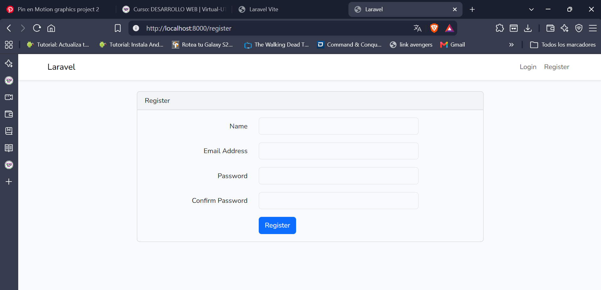

**Inicio de sesión (`/login`)**

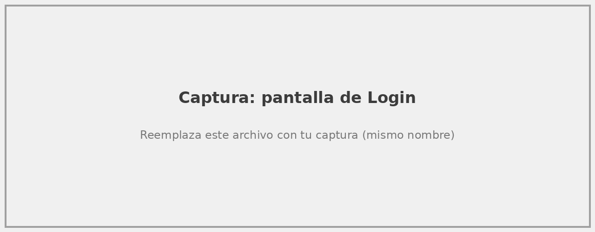

**Panel del usuario autenticado (`/home`)**: "You are logged in!"

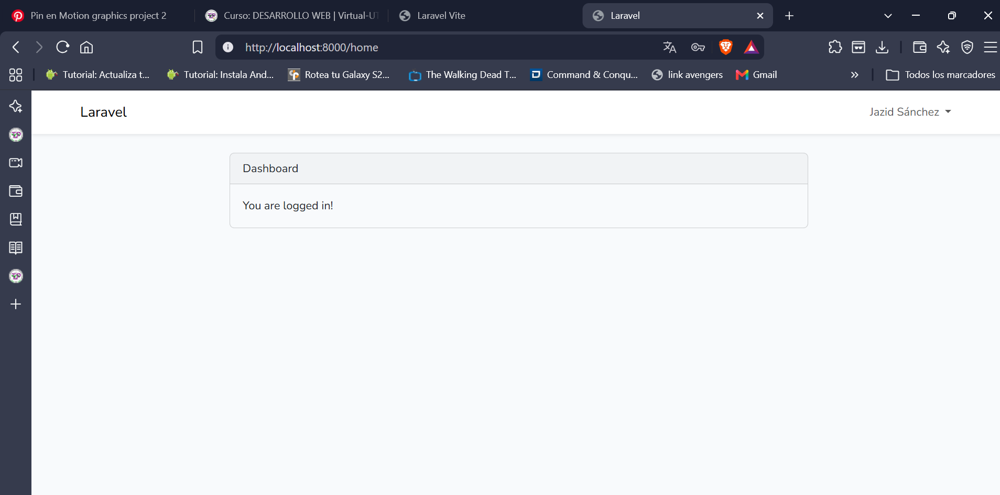

**Servidor y Vite corriendo con `composer run dev`**

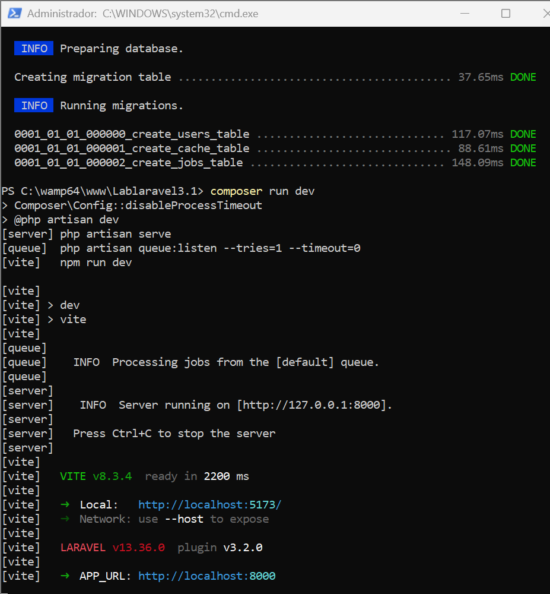

---

## 3. 🧰 Requisitos previos

| Icono | Tecnología | Requisito | Versión usada |
|:---:|---|---|---|
|  | **PHP** | 8.2 o superior (Laravel 13 lo exige) | 8.3.28 |
|  | **Composer** | Última versión estable | 2.10.3 |
|  | **Laravel Installer** | `laravel new` o `composer create-project` | 5.32.0 |
|  | **Laravel Framework** | Framework del laboratorio | 13.36.0 |
| 🟢 | **WampServer** | Paquete de servidor local (también sirve XAMPP o Laragon) | 3.4.0 (64 bits) |
|  | **Apache** | Servidor web | 2.4.65 |
|  | **MySQL** | Base de datos funcionando (puerto 3306) | 8.4.7 |
|  | **phpMyAdmin** | Administrar la base de datos | 5.2.3 |
|  | **Node.js** | Necesario para compilar Bootstrap con Vite | 24.21.0 |
|  | **npm** | Necesario (instala Bootstrap y Vite) | 11.19.0 |
|  | **Vite** | Compilador de recursos | 8.3.4 |
|  | **Bootstrap** | Diseño de los formularios | _(ver `npm list bootstrap`)_ |
|  | **Visual Studio Code** | Editor de código recomendado | — |
|  | **Git** | Control de versiones | — |
|  | **GitHub** | Repositorio remoto | — |
|  | **Sistema operativo** | Windows | Windows 11 |

**Verificación de versiones**

```powershell
php -v
composer -V
node -v
npm -v
```

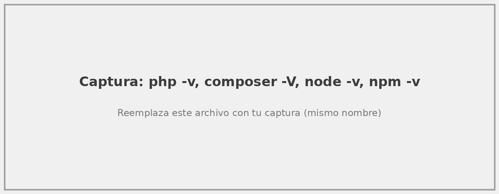

> **Nota:** el PATH de Windows debe apuntar a la misma versión de PHP que se activa en Wamp. En este laboratorio hubo que corregirlo (ver [Dificultad 1](#8--dificultades-y-soluciones)).

---

## 4. ⚙️ Instalación y flujo de comandos

### 4.1 Crear el proyecto desde cero (flujo seguido en el laboratorio)

```powershell
# 1. Instalar el instalador global de Laravel
composer global require laravel/installer
laravel --version

# 2. Crear el proyecto dentro de la carpeta www de Wamp
cd C:\wamp64\www
laravel new Lablaravel3.1
cd Lablaravel3.1
php artisan --version
```

Respuestas al asistente del instalador: starter kit **no**, frontend **Blade**, base de datos **MySQL**, migraciones por defecto **no**.

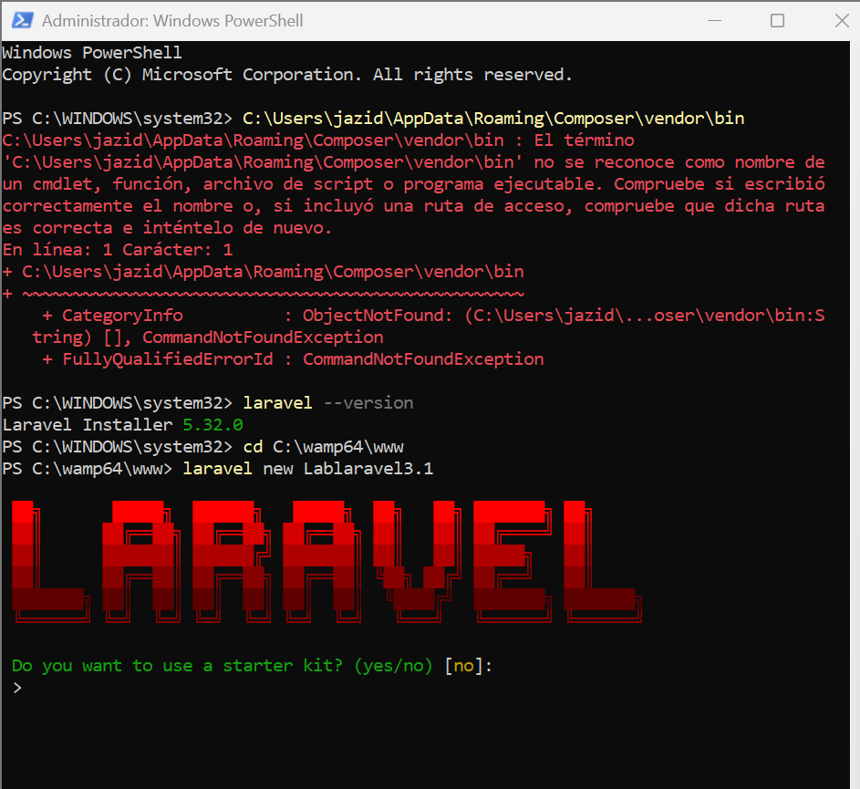

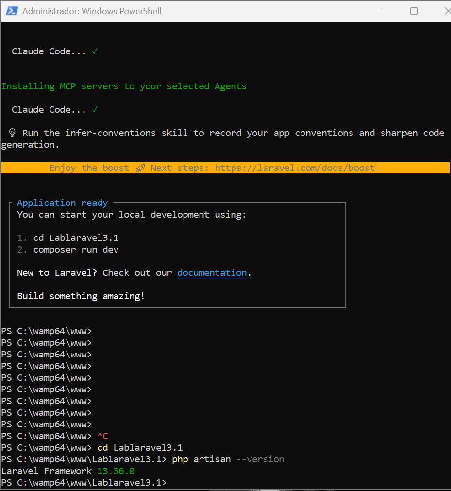

### 4.2 Dependencias de Laravel para la autenticación (`laravel/ui`)

```powershell
composer require laravel/ui
php artisan ui bootstrap --auth
npm install
npm run dev
```

> Alternativa: **Laravel Breeze** (`composer require laravel/breeze --dev` y `php artisan breeze:install`). En este laboratorio se utilizó `laravel/ui`.

### 4.3 Levantar el proyecto

```powershell
composer run dev
```

Este comando inicia en simultáneo `php artisan serve` (servidor), `queue:listen` (cola de trabajos) y `npm run dev` (Vite).

| Ruta | Función |
|---|---|
| http://localhost:8000/register | Registro de usuarios |
| http://localhost:8000/login | Inicio de sesión |
| http://localhost:8000/home | Panel (requiere sesión iniciada) |

### 4.4 Clonar y ejecutar el repositorio en otra computadora

```powershell
git clone https://github.com/jazidsanchez-create/Lablaravel3.1.git
cd Lablaravel3.1

composer install                 # Instala las dependencias de PHP (carpeta vendor)
copy .env.example .env           # Crea el archivo de entorno
php artisan key:generate         # Genera la clave de la aplicación
```

Edita el `.env` con los datos de tu base de datos (ver sección 5), crea la base `lablaravel31` en phpMyAdmin y continúa:

```powershell
php artisan config:clear
php artisan migrate              # O importa el respaldo database/backup/lablaravel31.sql
npm install
composer run dev
```

---

## 5. 🗄️ Base de datos

### 5.1 Entorno

- **Motor:** MySQL 8.4.7 (WampServer), administrado con phpMyAdmin 5.2.3.
- **Base de datos:** `lablaravel31` con cotejamiento `utf8mb4_unicode_ci`.
- **Puerto:** 3306.

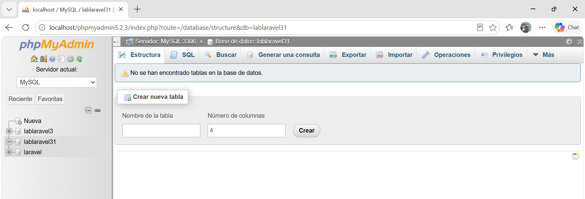

### 5.2 Configuración del `.env`

Laravel lee las credenciales de conexión desde el archivo `.env`:

```env
DB_CONNECTION=mysql
DB_HOST=127.0.0.1
DB_PORT=3306
DB_DATABASE=lablaravel31
DB_USERNAME=root
DB_PASSWORD=
```

Después de editarlo se limpia la caché con `php artisan config:clear`.

### 5.3 Ajustes de Laravel para evitar errores

**Longitud de cadena**, en `app/Providers/AppServiceProvider.php`:

```php
use Illuminate\Support\Facades\Schema;

public function boot(): void
{
    Schema::defaultStringLength(191);
}
```

**Motor de almacenamiento**, en `config/database.php`, dentro de la conexión `mysql`:

```php
'engine' => 'InnoDB',
```

### 5.4 Migraciones

```powershell
php artisan config:clear
php artisan migrate:fresh
```

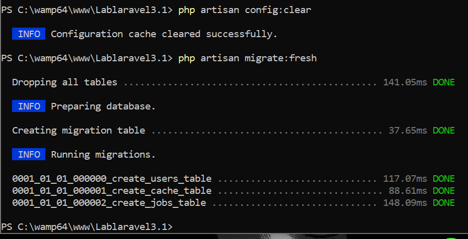

Tablas creadas: `users`, `password_reset_tokens`, `sessions`, `cache`, `cache_locks`, `jobs`, `job_batches`, `failed_jobs` y `migrations`.

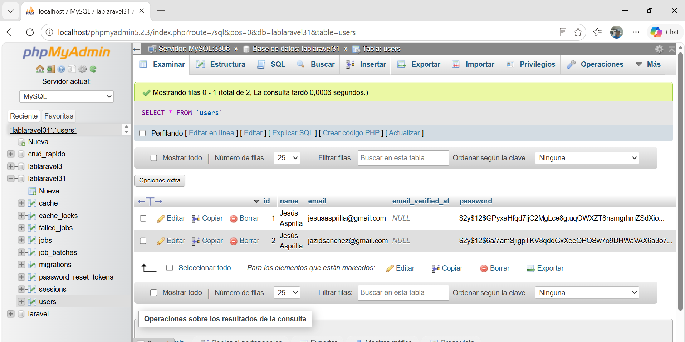

### 5.5 Respaldo (backup) de la base de datos

El respaldo se guarda en el repositorio en `database/backup/lablaravel31.sql`.

**Opción 1: phpMyAdmin.** Selecciona la base `lablaravel31` → pestaña **Exportar** → método **Rápido**, formato **SQL** → **Exportar**. Guarda el archivo en `database/backup/`.

**Opción 2: línea de comandos.** Ajusta la carpeta según tu versión de MySQL en Wamp:

```powershell
cd C:\wamp64\www\Lablaravel3.1
& "C:\wamp64\bin\mysql\mysql8.4.7\bin\mysqldump.exe" -u root --result-file="database\backup\lablaravel31.sql" lablaravel31
```

**Restaurar el respaldo:**

```powershell
& "C:\wamp64\bin\mysql\mysql8.4.7\bin\mysql.exe" -u root lablaravel31 -e "source database/backup/lablaravel31.sql"
```

---

## 6. 🎛️ Controles utilizados

| Control | Dónde se usa | Descripción |
|---|---|---|
| Campo de texto (`input text`) | Registro: *Name* | Nombre del usuario |
| Campo de correo (`input email`) | Registro y login: *Email Address* | Correo, único en la tabla `users` |
| Campo de contraseña (`input password`) | Registro y login: *Password* | Se guarda encriptada (bcrypt) |
| Confirmación de contraseña | Registro: *Confirm Password* | Debe coincidir con *Password* |
| Casilla (`checkbox`) | Login: *Remember Me* | Mantiene la sesión iniciada |
| Botones (`submit`) | *Register*, *Login*, *Logout* | Envían los formularios |
| Enlaces | *Forgot Your Password?*, *Login*, *Register* | Navegación entre vistas |
| Menú desplegable | Barra superior con el nombre del usuario | Contiene *Logout* |

**Otros elementos de Laravel:** directivas Blade (`@extends`, `@section`, `@csrf`, `@error`, `@guest`, `@auth`), validación del lado del servidor, protección CSRF y middleware `auth` para proteger `/home`.

---

## 7. ✅ Evidencias: inserción de registros

Al registrar un usuario desde `/register`, Laravel valida los datos y los inserta en la tabla `users`.

**Validación de campos obligatorios**

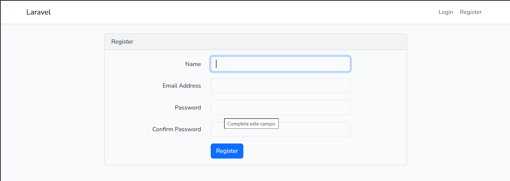

**Formulario de registro completo**


**Registros insertados en la base de datos (phpMyAdmin → `lablaravel31` → `users`)**


---

## 8. 🛠️ Dificultades y soluciones

Durante la ejecución del laboratorio se presentaron las siguientes complicaciones:

- **Dificultad 1: La terminal usaba PHP 8.0.30 y no el 8.3.28 seleccionado en Wamp.** Composer instaló una versión antigua del instalador de Laravel y mostró el aviso de que requería PHP ^8.2.
  - **Solución:** Cambiar la versión desde el menú de Wamp no actualiza el PATH de Windows. Se eliminó la entrada `C:\wamp64\bin\php\php8.0.30` de la variable Path, se dejó `php8.3.28` y se reinstaló el instalador con `composer global remove laravel/installer` y `composer global require laravel/installer`.

  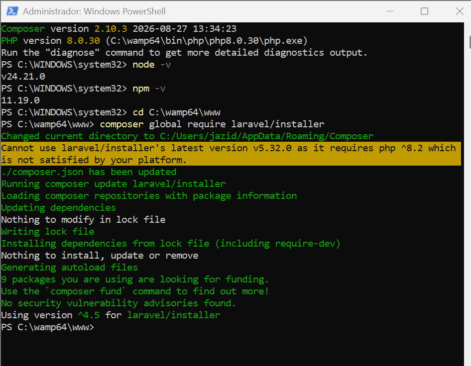

  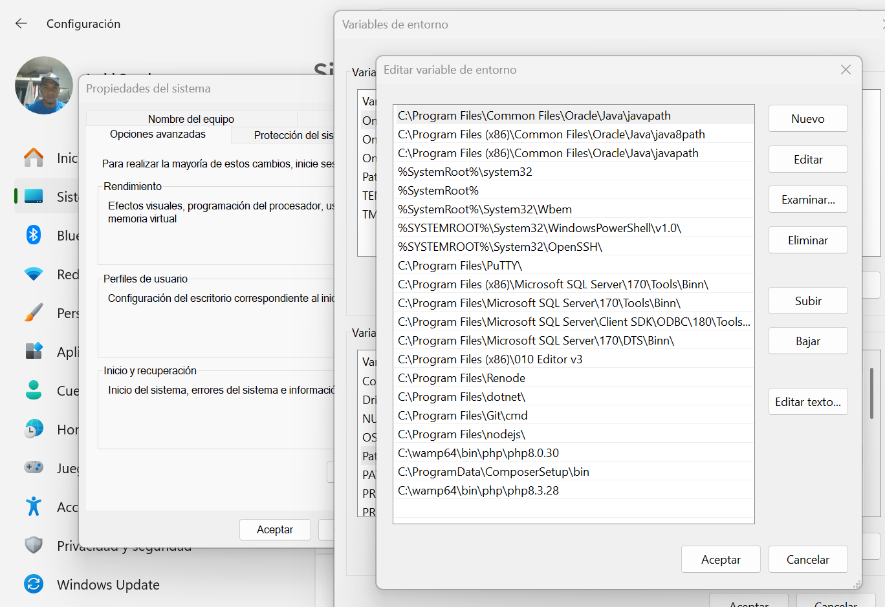

- **Dificultad 2: Error `Table 'users' already exists` al migrar.** El `.env` seguía apuntando a la base por defecto `laravel`, que ya tenía tablas de otro proyecto.
  - **Solución:** Se creó la base `lablaravel31` en phpMyAdmin, se actualizó `DB_DATABASE` en el `.env` y se ejecutó `php artisan config:clear`.

  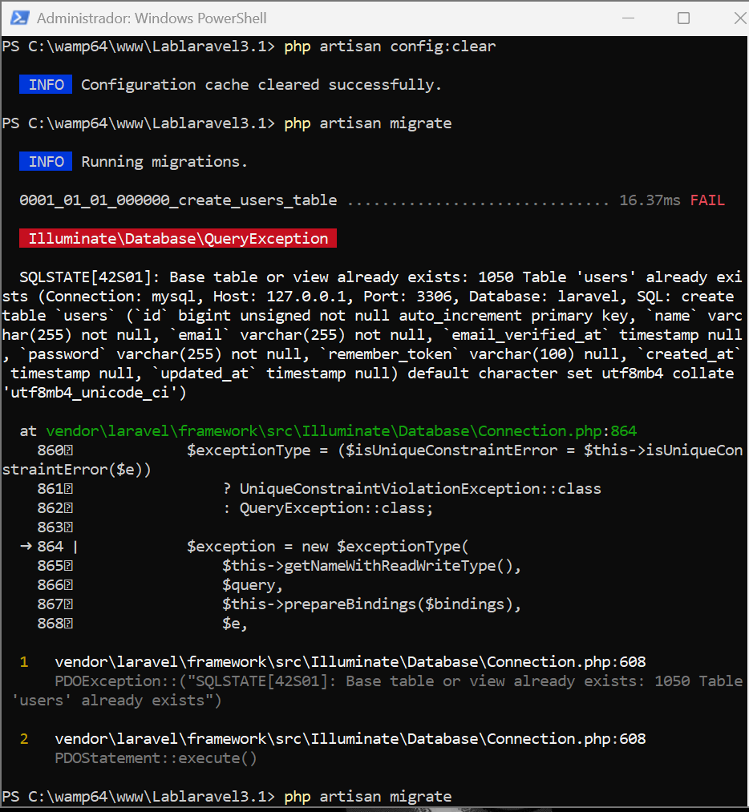

- **Dificultad 3: Error `1071 Specified key was too long` en la tabla `users`.** El índice único del campo `email` (255 caracteres en `utf8mb4`) superaba el límite de 1000 bytes.
  - **Solución:** Se agregó `Schema::defaultStringLength(191);` en el método `boot()` de `AppServiceProvider.php`.

  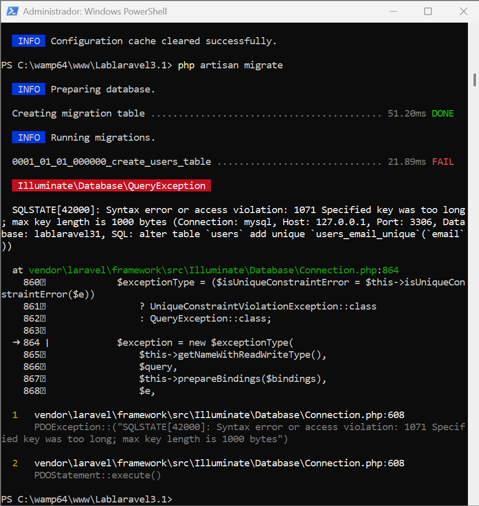

- **Dificultad 4: Tablas creadas a medias tras el error anterior.** La migración falló después de crear `users` y volver a ejecutar `migrate` repetía el error de tabla existente.
  - **Solución:** Se usó `php artisan migrate:fresh`, que borra las tablas de la base configurada y las crea de nuevo.

- **Dificultad 5: Error `1071` otra vez, ahora en `failed_jobs`.** El motor por defecto era MyISAM, que limita los índices a 1000 bytes.
  - **Solución:** Se fijó `'engine' => 'InnoDB'` en la conexión `mysql` de `config/database.php` y se volvió a ejecutar `php artisan migrate:fresh`.

  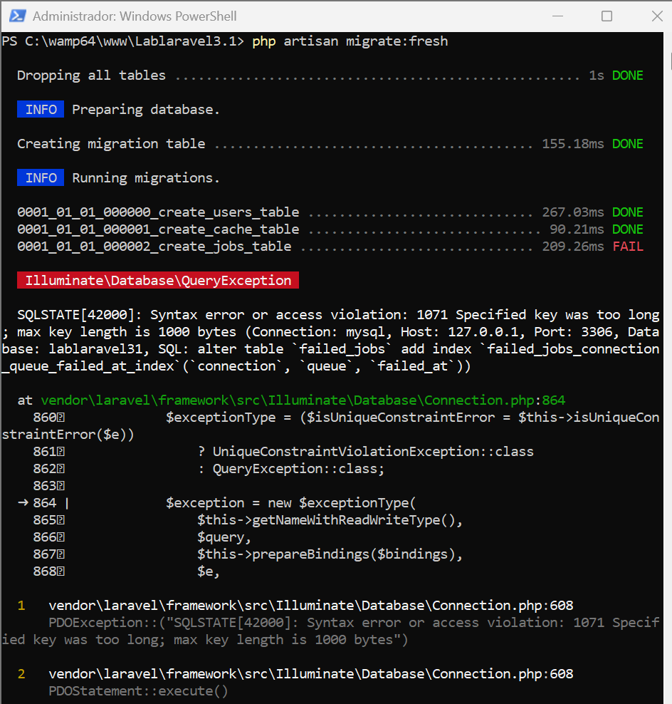

- **Dificultad 6: La página de bienvenida (`/`) se veía sin estilos.** Esa página usa Tailwind y `laravel/ui` reemplaza los estilos por Bootstrap.
  - **Solución:** Es un comportamiento esperado. Las vistas del laboratorio (`/login`, `/register` y `/home`) usan Bootstrap y se muestran correctamente.

  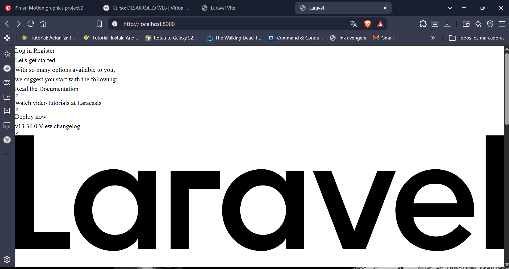

- **Dificultad 7: Error `Value "cd Lablaravel3.1" is invalid` durante la creación del proyecto.** Se escribió un comando mientras el asistente de Laravel Boost esperaba una opción del menú.
  - **Solución:** Se aceptó la opción por defecto y se esperó a que el instalador terminara antes de escribir comandos.

---

## 9. 📚 Referencias

1. Fong, I. (2026). *Guía de Laboratorio: Cómo crear un Login y Registro en Laravel*. Universidad Tecnológica de Panamá.
2. Laravel. *Installation*. https://laravel.com/docs/installation
3. Laravel. *Database: Migrations*. https://laravel.com/docs/migrations
4. Laravel. *Laravel UI (repositorio oficial)*. https://github.com/laravel/ui
5. Composer. *Documentación*. https://getcomposer.org/doc/
6. Vite. *Guía oficial*. https://vite.dev/guide/
7. Bootstrap. *Documentación*. https://getbootstrap.com/docs/
8. MySQL. *The InnoDB Storage Engine*. https://dev.mysql.com/doc/refman/8.4/en/innodb-storage-engine.html

---

## 10. 📅 Fecha de ejecución

El laboratorio se realizó el **14 de octubre de 2026**.

---

<div align="center">

### 🎓 Información del estudiante

Este laboratorio ha sido desarrollado por el estudiante de la **Universidad Tecnológica de Panamá**:

**Nombre:** Jazid Sánchez
**Correo:** _(jazid.sanchez@utp.ac.pa)_
**Curso:** Desarrollo Web
**Instructor del Laboratorio:** Irina Fong

</div>
